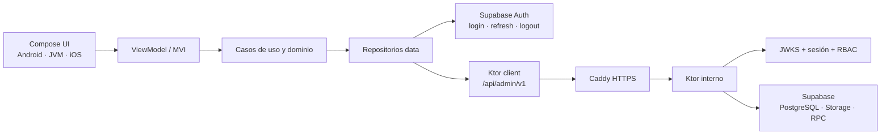

# AI Context Map — OposiControl

Fecha de corte: 2026-07-29
Alcance: aplicación administrativa Kotlin Multiplatform, backend Ktor, Supabase y despliegue VPS.
Exclusión obligatoria: `NEWS=FROZEN`.

## Estado ejecutivo

El repositorio está en una migración activa desde contratos y rutas heredadas hacia una API administrativa canónica. La dirección arquitectónica está decidida y una parte sustancial ya existe, pero el estado de este corte sigue siendo **No-Go para producción** hasta completar y demostrar los gates de seguridad, migración, atomicidad, integración cliente-servidor y despliegue.

La fuente de verdad de estado y bloqueos es
[`IMPLEMENTATION_STATUS_2026-07-29.md`](IMPLEMENTATION_STATUS_2026-07-29.md). Las
decisiones estables están en [`DECISIONS.md`](DECISIONS.md).

## Modelo mental

- El cliente solo debe acceder directamente a Supabase para Auth.
- Los datos administrativos y de negocio deben viajar por Ktor.
- Ktor obtiene el actor de `sub`, valida JWT y sesión, exige permisos y llama a
  Supabase con el contexto apropiado.
- El esquema canónico usa nombres españoles en singular e IDs enteros.
- Las rutas `/content`, `/admin` y `/v1` son compatibilidad heredada, no el
  contrato de destino.

## Jerarquía de fuentes

En caso de contradicción, resolver en este orden:

1. Solicitud y plan aprobado del usuario.
2. `AGENTS.md`.
3. Migraciones versionadas en `supabase/migrations`.
4. Contratos serializables de `core/api`.
5. Rutas y gateways Ktor realmente registrados en `Application.kt`.
6. Repositorios y DI del cliente realmente activos.
7. Documentación de `docs/` y `README.md`.

Una ruta declarada en `AdminApiRoutes` no cuenta como implementada hasta estar
registrada en Ktor, consumida por el repositorio correcto y cubierta por una
prueba de contrato/integración.

## Mapa de módulos

| Zona | Ruta | Responsabilidad | Dependencias permitidas |
|---|---|---|---|
| Aplicación | `composeApp` | raíz, navegación, configuración por plataforma | features, core, data |
| Contrato HTTP | `core/api` | DTO serializables, rutas, errores y paginación | serialización; no dominio |
| Núcleo compartido | `core/common` | MVI, configuración, logging, IDs operativos | utilidades KMP |
| Red | `core/network` | cliente Ktor, retry, timeout y cabeceras | `core/api`, `core/common` |
| Persistencia local | `core/database` | SQLDelight no sensible | nunca tokens en claro |
| Diseño | `core/ui` | tema, métricas y primitivas glass | Compose |
| Dominio | `domain` | modelos, repositorios y casos de uso | no transporte |
| Datos | `data` | adaptadores remotos/locales y mapeos | dominio, core |
| Features | `features/*` | Route, ScreenContent, UiState, Action, Effect, VM | dominio y core |
| Backend | `backend/ktor` | autenticación, autorización, API y Supabase | `core/api`, Ktor |
| Base de datos | `supabase` | migraciones, RLS, RPC, Storage y pgTAP | PostgreSQL/Supabase |
| Operación | `deploy`, `scripts/logs` | Docker, Caddy, runbooks y captura | infraestructura |

## Contratos canónicos

`core/api` contiene actualmente:

- Primitivas: `CursorPage<T>`, `ApiErrorResponse`, `ApiFieldError`,
  `HealthResponse`, `AdminApiRoutes` y `AdminApiHeaders`.
- Identidad: `AdminPrincipalResponse`, `PermissionResponse`, `RoleResponse`,
  `UserResponse`, preferencias y auditoría.
- Contenido: `ExamType`, `ExamAccessType`, `PublicationStatus`, especialidades,
  exámenes, preguntas, opciones y recursos.
- Operación: accesos, carteras, transacciones, soporte y moderación.
- Comercio y descubrimiento: artículos, ofertas, recursos limitados, campañas,
  dashboard y búsqueda.

Nombres que difieren del texto inicial del plan:

| Nombre del plan | Nombre materializado |
|---|---|
| `ExamStatus` | `PublicationStatus` |
| `ErrorEnvelope` | `ApiErrorResponse` |
| `AdminPrincipal` público | `AdminPrincipalResponse` |
| `Permission` público | `PermissionResponse` |
| `LogEvent`, `OperationContext` en `core/api` | están en `core/common` |

Estas diferencias son compatibles si se mantienen estables desde este corte;
renombrarlas exigiría migración explícita de consumidores.

## Modelo canónico Supabase

Las migraciones `20260729000100` a `20260729000700` establecen:

- tablas administrativas singulares con IDs `int4`/`integer`;
- `especialidad`, `examen`, `pregunta`, `opcion_pregunta` y
  `recurso_pregunta`;
- `app_permission`, `app_role`, `role_permission` y `user_role`;
- RLS, grants y permisos administrativos;
- RPC transaccionales para tickets, accesos, roles, soporte y moderación;
- backfill de preguntas heredadas, Storage privado y migración de ráfagas;
- importación/reordenación atómica con idempotencia.

Antes de usar el esquema remoto se necesita snapshot, inventario de
consumidores, backup restaurable y ejecución local de migraciones/pgTAP. No se
autoriza reset destructivo remoto.

## Autenticación y secretos

- Cliente: `SUPABASE_PUBLISHABLE_KEY`.
- Backend/VPS: `SUPABASE_SECRET_KEY`.
- La sesión se cifra mediante Android Keystore, iOS Keychain y un almacén JVM
  seguro o efímero.
- Ktor valida firma JWKS, `iss`, `aud`, `exp`, `sub`, `session_id` y consulta
  `/auth/v1/user` para rechazar sesiones revocadas.
- `BOOTSTRAP_ADMIN_EMAIL` solo sirve para inicialización controlada; debe
  retirarse tras crear el primer superadministrador.
- El alias `SUPABASE_SERVICE_ROLE_KEY` solo se conserva temporalmente para el
  código congelado de Noticias.

## UI, estado y logging

- Paleta inmutable: fondos `#EAF1F8`/`#D6E4F2`, acento `#FF8A5B`, texto
  `#142230`/`#516173`, error `#B84B3B`; glass blanco 40–53 %.
- Medidas raíz: breakpoints 600/840/1200 dp, rail 72 dp, navegación ancha
  280 dp; campos 52 dp, botones 48 dp, top bar 64 dp, bottom bar 72 dp.
- Patrón de pantalla: `Route` conecta VM y efectos; `ScreenContent(state,
  onAction)` es puro.
- Estado: `UiState` inmutable, `Action` tipada y `Effect` de consumidor único.
- Logging permitido: eventos estructurados y campos allowlist con tags
  `OC-UI`, `OC-VM`, `OC-REPO`, `OC-NET`, `OC-UPLOAD`, `OC-KTOR`, `OC-SUPA`.
- Nunca registrar tokens, claves, PII, cuerpos, preguntas, búsquedas, archivos,
  queries ni URLs sensibles.

## Congelación de Noticias

No modificar:

- `features/news/**`;
- `features/news-types/**`;
- `backend/ktor/src/main/kotlin/com/oposicontrol/backend/NewsGateway.kt`;
- endpoints, SQL, editor o métricas específicas de Noticias;
- `MobileLayeredNewsEditor.kt`, aunque esté físicamente bajo `features/exams`.

Los cambios compartidos deben compilar y superar regresión sin cambiar el
comportamiento de Noticias. Su creación/editor completo pertenece al plan
posterior de los seis participantes.

## Puntos de entrada al investigar

| Pregunta | Leer primero |
|---|---|
| ¿Qué contrato debe usar una pantalla? | `core/api`, luego rutas Ktor |
| ¿Qué tabla/RPC es canónica? | `supabase/migrations`, en orden |
| ¿Qué implementación usa realmente el cliente? | `data/.../DataModule.kt` |
| ¿Qué ruta se sirve realmente? | `backend/ktor/.../Application.kt` |
| ¿Cómo modelar un ViewModel? | `core/common/.../MviViewModel.kt` y una feature migrada |
| ¿Qué UI y medidas son válidas? | `core/ui/.../theme`, `layout` y componentes |
| ¿Qué se puede registrar? | `docs/observability/logging-runbook.md` |
| ¿Cómo desplegar? | `docs/deployment/backend-production-runbook.md` |
| ¿Qué sigue bloqueado? | `docs/IMPLEMENTATION_STATUS_2026-07-29.md` |

## Guardas antes de integrar

1. Verificar que el archivo no tiene otro propietario activo.
2. Confirmar contrato, tabla/RPC, permiso y error antes de UI/lógica.
3. Mantener `NEWS=FROZEN`.
4. Exigir prueba del corte, logs seguros y build verde.
5. Para SQL: backup, dry-run, pgTAP, RLS por rol y rollback ensayado.
6. Para producción: imagen inmutable, secretos externos, Caddy válido y Ktor
   sin puerto público.
